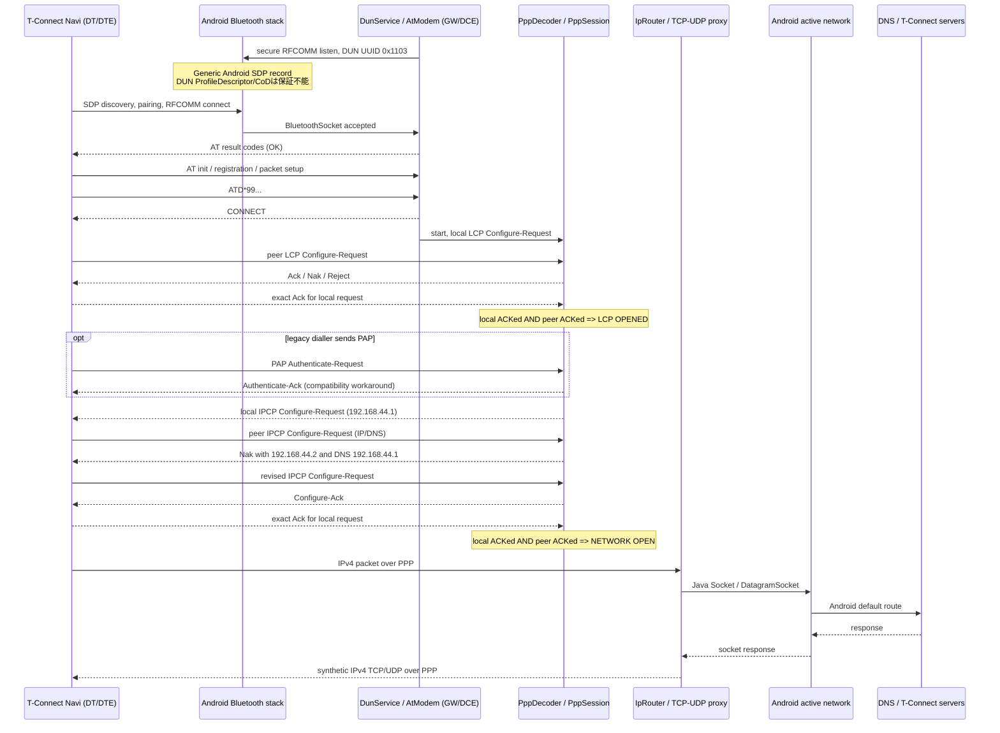
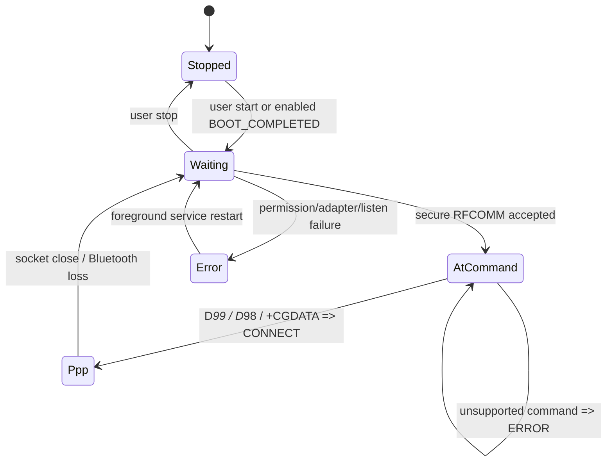
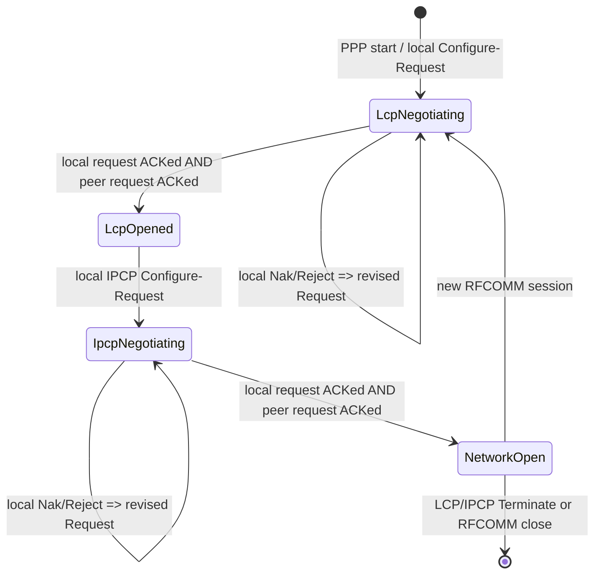
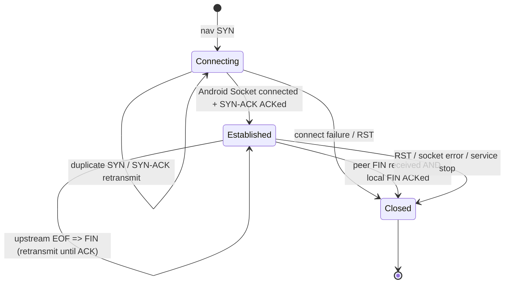

# DUNavi state machine

## End-to-end sequence

## Service / AT states

`AtModem` の legacy tolerance は allowlist 方式である。`+CGQREQ`, `+CGQMIN`, `+CGEREP`, `+CGAUTO`, `+CGACT`, `+CGCLASS` の設定は副作用なしで `OK`、それ以外の未知 command は `ERROR` とする。

## LCP / IPCP states

同じ identifier でも option byte列が異なる Configure-Ack は受理しない。Configure-Request は 3 秒ごと、最大 10 回再送する。完全な RFC 1661 automaton（Opened 後の再configure、Code/Protocol-Reject、Failure counter）は未実装である。

## TCP proxy states

これはナビ側 TCP を終端して Android `Socket` へ中継する最小 proxy であり、raw NAT ではない。zero/small receive window、部分 ACK、32-bit wrap、SYN/data/FIN 再送を扱うが、SACK、timestamps、congestion control、完全な TIME_WAIT は提供しない。

## 一回の実車試験で見る境界

| 最後に見えたログ | 到達点 | 次に疑う箇所 |
|---|---|---|
| `DUN待受開始 (secure RFCOMM)` のみ | Android は待受中 | SDP ProfileDescriptor/CoD 制約、pairing、ナビ設定 |
| `RFCOMM CONNECTED` | Bluetooth/RFCOMM 成立 | AT command/parser |
| `AT RX...` だが `CONNECT` なし | modem init 途中 | 直前 command と result。値は共有時に伏せる |
| `LCP ...` だが `LCP OPENED` なし | PPP framing/LCP | Ack ID/content、Nak/Reject、option、FCS |
| `LCP OPENED` だが `NETWORK OPEN` なし | IPCP | address/DNS option と双方向 Ack |
| `NETWORK OPEN` だが DNS 成功なし | IPv4/DNS | upstream DNS、UDP、fragment/ICMP の packet capture |
| `DNS/TX IPv4 response built` だが TCP established なし | name resolution 後 | destination reachability、SYN/SYN-ACK/ACK |
| `TCP ... ESTABLISHED` | end-to-end TCP proxy 成立 | TLS/T-Connect application、契約/センター側 |

詳細は [vehicle-test-checklist.md](vehicle-test-checklist.md) を参照する。
